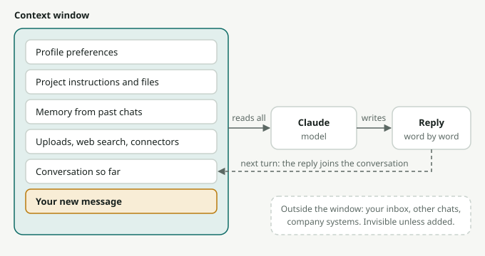

# Module 1: How Claude Actually Works

**Track A · Foundations · ~20 minutes**

You don't need to understand the maths to drive a car well, but you do need to know that it has brakes and a fuel tank. This module covers the handful of facts about Claude that change how you use it.

## What Claude is

Claude is a **large language model (LLM)** made by Anthropic. It was trained on a very large amount of text (books, websites, code, and more) and then further trained to be helpful, honest, and careful. When you send it a message, it writes a response one small piece at a time, each piece chosen based on everything that came before it in the conversation.

Two consequences matter:

- **Claude is very good at language tasks**: writing, summarising, explaining, translating, reasoning through problems, analysing documents, writing code, and following detailed instructions.
- **Claude can sound confident and still be wrong.** It produces plausible text. Most of the time plausible and correct are the same thing. Sometimes they aren't, especially for specific facts, numbers, names, quotes, and recent events. This is called a **hallucination**. Module 5 covers how to manage it.

## Six facts that change how you use it

### 1. Claude only knows what's in the conversation (plus its training)

Claude doesn't know who you are, what HotelBFF does, what you discussed yesterday, or what's in your inbox, unless:

- you tell it in the chat,
- you upload files or connect tools (Modules 4 and 11), or
- you use features that carry context across chats, like **Projects** and **memory** (Module 6).

**Most bad answers come from missing context, not from a weak model.** Treat Claude like a brilliant new colleague on their first day: smart, fast, eager, and missing all the background.

*How a reply is made: Claude reads everything in the context window, writes a reply, and that reply becomes part of the conversation for the next turn. Anything outside the window, like your inbox or yesterday's chats, doesn't exist for Claude unless a feature or you put it inside.*

### 2. It has a training cutoff

Claude's built-in knowledge stops at a certain date. For anything recent (news, prices, new regulations, a competitor's latest launch), turn on **web search** or give it the source material yourself.

### 3. The context window is its working memory

Everything in a conversation (your messages, Claude's replies, uploaded files) has to fit in the **context window**. It's large (hundreds of pages of text), but not infinite. Very long chats can get slower, and older details can get less attention.

**Practical rule:** one chat per task. When you switch topics, start a new chat. When a long chat gets messy, ask Claude to "summarise everything we've decided so far" and paste that summary into a fresh chat.

### 4. It's not a search engine (unless you make it one)

A search engine finds existing pages. Claude *generates* answers. That makes it much better for "help me think through this", "draft this", "explain this", and "compare these". Without web search turned on, it is worse for "what is the exact current price of X".

### 5. It responds to how you ask

The same question asked two ways can get a mediocre answer or an excellent one. Detail, examples, and a clear goal all improve the output. Module 3 is entirely about this.

### 6. It can do things, not just say things

Claude can do more than chat. It can:

- create documents, spreadsheets, slide decks, and small interactive apps (**Artifacts** and file creation),
- search the web and run multi-step **Research**,
- read and act in your connected tools like email, calendar, and drive (**Connectors**),
- work through long, multi-step tasks on its own as an **agent** (Claude Code, Cowork, Claude in Chrome).

The later modules cover each of these.

## The model family

Claude comes in a few sizes. The names change with each generation, but the pattern holds:

| Tier | Good for | Trade-off |
|---|---|---|
| **Opus** (largest) | Hard reasoning, complex writing, long agentic tasks, deep analysis | Slower; uses your usage limits faster |
| **Sonnet** (balanced) | Most everyday work: writing, analysis, coding | Strong default for most people |
| **Haiku** (smallest) | Quick, simple, high-volume tasks | Less depth on hard problems |

As of this writing the current family is Claude 5 (for example Opus 5.5, Sonnet 5.5 and Haiku 5.5). You'll see the exact names in the model picker. **Start with the default.** Switch to the most capable model when a task is hard or high-stakes, and to a faster one when you want speed.

Many models also offer **extended thinking**: Claude reasons step by step before answering. Turn it on for maths, planning, tricky analysis, or decisions with many moving parts. Leave it off for quick tasks.

## How Claude is designed to behave

Anthropic trains Claude to be helpful, honest, and harmless. In practice:

- It will tell you when it's unsure, if you let it. ("If you don't know, say so" is a useful line to add.)
- It may push back or decline when asked to do something harmful or deceptive.
- It aims to give balanced views on contested topics.
- It is not a doctor, lawyer, or financial adviser. It can help you understand and prepare, and you should still confirm high-stakes decisions with a qualified person.

## Try it

1. **Test the context gap.** Ask Claude: *"Write a welcome email for our new guests."* Then open a new chat and ask again, but first give it three sentences about a real or imagined property: its name, location, the kind of guest it attracts, and the tone you want. Compare the two results.
2. **Test the cutoff.** Ask: *"What's your knowledge cutoff, and what kinds of questions should I double-check because of it?"*
3. **Test thinking.** Give it a planning problem, such as *"I have 3 days in Lisbon with a 6-year-old and a grandparent who can't walk far. Plan it."* Try it with extended thinking off and then on. Notice the difference in depth.

## Key takeaways

- Claude is a language model: excellent at language and reasoning, and capable of confident mistakes.
- **Context is everything.** Give it the background a new colleague would need.
- One chat per task. Use web search or your own sources for anything recent or exact.
- Use bigger models and extended thinking for hard problems, and defaults for everything else.
