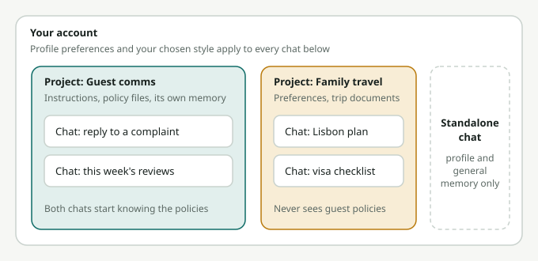

# Module 6: Projects, Memory, and Styles

**Track B · Everyday leverage · ~20 minutes**

Module 1 said Claude only knows what's in the conversation. These three features fix that, so you stop re-explaining yourself.

## Projects: a workspace with built-in context

A **Project** is a folder for related chats that shares:

- **Project instructions**: standing guidance applied to every chat in the project
- **Project knowledge**: files Claude can refer to in every chat (documents, guidelines, data, past examples)

Every new chat inside the project starts already knowing the background.

### Good projects to create

**At work**
- **"Guest Communications"**: your brand voice guide, sample emails you liked, policies (cancellation, refunds, pets), and the instruction *"Always write in our brand voice; never promise anything outside the attached policies."*
- **"Sales Enablement"**: product one-pagers, pricing, case studies, common objections and answers.
- **"Monthly Reporting"**: your report template, last month's report, metric definitions.
- **"Hiring"**: job descriptions, the interview rubric, the company values.

**Personal**
- **"Family Travel"**: everyone's preferences, dietary needs, passport expiry months (not numbers), budget norms.
- **"Health & Fitness"**: your goals, routines, and constraints (and the reminder that it's not medical advice).
- **"Learning Spanish"** (or anything): your level, goals, and instructions to quiz you.

### Writing good project instructions

Keep them short and specific. For example:

```
You are helping the HotelBFF partnerships team.
- Audience: independent hotel owners in India, often not tech-savvy.
- Tone: friendly, plain English, no jargon, no hype.
- Always use the attached pricing sheet; never invent prices or discounts.
- When drafting outreach, keep emails under 120 words with one clear ask.
- If information is missing, ask rather than assume.
```

### Sharing projects

On Team and Enterprise plans you can share projects with colleagues. A well-built shared project captures the team's best practices: new joiners get the same quality output as veterans from day one.

## Memory: Claude remembers you across chats

With **memory** enabled (availability depends on your plan), Claude can remember useful things from past conversations, such as your role, ongoing projects, and preferences, and use them in later chats. You can also ask it to search past chats: *"What did we decide about the offsite venue last week?"*

**You're in control:**
- See and edit what Claude remembers in Settings.
- Tell it directly: *"Remember that I prefer answers in bullet points."* or *"Forget what I told you about X."*
- Use **incognito chats** for conversations you don't want remembered.
- Memory is kept separate per project, so work context doesn't leak into personal projects.

## Styles: how Claude writes

**Styles** change the voice and format of Claude's responses: more concise, more explanatory, more formal, or a **custom style**. You can create one by uploading samples of your own writing. Claude then drafts in a way that sounds more like you.

Good uses:
- a "My emails" style trained on 3–5 emails you've written
- a "Board update" style that's tight, numeric, and leads with decisions
- a "Teach me" style that explains step by step with examples


*What each chat inherits: profile preferences and styles reach every chat, a project adds its instructions, files and memory only to its own chats, and projects never see each other's context.*

## Profile preferences vs. projects vs. memory vs. styles

| Feature | Scope | Use it for |
|---|---|---|
| **Profile preferences** | Every chat | Who you are and universal preferences (language, units, format) |
| **Project instructions and knowledge** | Chats in that project | Task-specific rules and reference documents |
| **Memory** | Across chats (per project) | Things learned over time from your conversations |
| **Styles** | When selected | How the writing sounds |

## Try it

1. **Build one work project** for a task you repeat every week. Add instructions plus 2–3 reference files. Run your next three instances of that task inside it.
2. **Build one personal project** (travel, fitness, learning, or home).
3. **Create a custom style** from three emails you've written. Draft a new email with it and compare it to the default.
4. If memory is on, ask: *"What do you remember about me?"* Edit anything that's wrong.

## Key takeaways

- Projects give Claude standing context and files, so you stop repeating yourself.
- Short, specific project instructions beat long, vague ones.
- Memory carries context across chats. You can see it, edit it, and turn it off.
- Styles make the writing sound the way you want, including like you.
