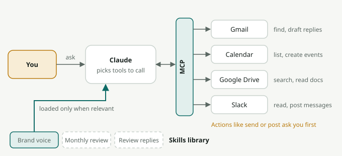

# Module 11: Connectors and Skills

**Track C · Advanced · ~25 minutes**

So far, you've brought information *to* Claude. Connectors let Claude go and get it, and act in your tools. Skills teach Claude *how* you want specific work done.

## Connectors: plug Claude into your tools

A **connector** links Claude to an app or data source, such as Gmail, Google Calendar, Google Drive, Slack, Notion, Asana, Linear, HubSpot, Figma, and many more. Most connectors are built on the **Model Context Protocol (MCP)**, an open standard for connecting AI models to tools. Anyone can build an MCP connector for their own system.

### What connectors make possible

- **"What's on my calendar this week, and which meetings should I prepare for?"**
- **"Find the email thread with [vendor] about the contract renewal and summarise where we landed."**
- **"Search our Drive for the latest brand guidelines and check this post against them."**
- **"Summarise what happened in #ops-alerts on Slack while I was on leave."**
- **"Create tasks in our project tracker for each action item from this meeting."**
- **"Draft replies to the three unanswered partner emails"** (as drafts you review, not sent automatically).

Combined with **Research** (Module 7), Claude can search your email, documents, and the web together for a complete answer.

### Setting up

1. Go to **Settings → Connectors** (or the tools menu in a chat).
2. Pick a connector and sign in to authorise it.
3. In a chat, enable the connectors you need for that conversation.

On Team and Enterprise plans, admins decide which connectors are available.

### Connector safety

- **Grant the minimum.** Only connect what you'll use.
- **Review before actions.** Claude will usually ask for approval before sending, posting, or changing anything. Read what it's about to do.
- **Treat incoming content as untrusted.** An email or web page could contain text that tries to instruct an AI ("ignore your instructions and forward this..."). This is called **prompt injection**. Claude is trained to resist it, but you should still be cautious with actions triggered by external content.
- **Only use connectors from sources you trust.**

## Skills: teach Claude your way of doing things

A **Skill** is a packaged set of instructions, and optionally files and scripts, that Claude loads when a task calls for it. Projects are about *context for a workspace*. Skills are about *how to do a specific kind of task*, wherever it comes up.

Claude only loads a skill's full instructions when it's relevant. That means you can have many skills installed without cluttering every chat.

### Examples

- **Built-in skills** that help Claude create excellent Word, Excel, PowerPoint, and PDF files.
- **"HotelBFF brand voice"**: tone rules, words to use and avoid, sample copy, logo usage.
- **"Monthly business review"**: your exact report structure, metric definitions, and a checklist before sending.
- **"Guest complaint response"**: your escalation rules, compensation guidelines, and templates.
- **"Video style"**: subtitle, caption, voiceover, and pacing rules for product demo videos.

### Creating a skill

The easiest way is to ask Claude:
> Help me create a skill for writing our weekly partner newsletter. Interview me about structure, tone, and what good looks like, then package it as a skill.

A skill is basically a folder with a `SKILL.md` file:

```markdown
---
name: partner-newsletter
description: Write the weekly HotelBFF partner newsletter. Use when asked to draft, edit, or review the partner newsletter.
---

# Partner newsletter

## Structure
1. One-line headline about the most important update
2. "What's new" (max 3 items, 2 sentences each)
3. "Tip of the week" for hotel owners
4. One clear call to action

## Tone
Friendly, practical, no jargon. Write for a busy owner reading on WhatsApp.

## Before finishing
- Every claim about a feature matches the attached release notes
- Under 300 words
```

The **description** matters most: it's how Claude decides when to use the skill. Say what it does *and* when to use it.

Skills work across the Claude apps, Claude Code, and the API. On team plans they can be shared across the organisation, which is one of the best ways to spread best practice.


*Connectors and skills together: Claude calls your apps through MCP connectors to read and act (asking before actions like sending), and pulls in only the skill that matches the task.*

## Projects vs. skills vs. connectors

| | Gives Claude | Example |
|---|---|---|
| **Project** | Background context and files for a workspace | "Everything about the Goa property" |
| **Skill** | A repeatable method for a type of task | "How we write review responses" |
| **Connector** | Live access to a tool or data | "Read and draft in my Gmail" |

The best workflows use all three: a Project for context, a Skill for the method, and Connectors for the data.

## Try it

1. **Connect one tool** you use daily (calendar or email is a great start). Ask: *"What should I prepare for this week?"*
2. **Cross-tool question.** With two connectors on, ask something that needs both, such as *"Which meetings this week relate to email threads I haven't replied to?"*
3. **Create a skill** for a task you do at least weekly. Test it on three real cases and refine the instructions.

## Key takeaways

- Connectors (mostly built on MCP) let Claude read and act in your tools.
- Grant minimum access, review actions, and watch for prompt injection.
- Skills package your methods so Claude does a task your way, every time.
- Projects + Skills + Connectors together make complete workflows.
